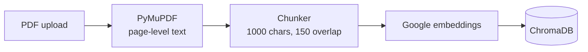
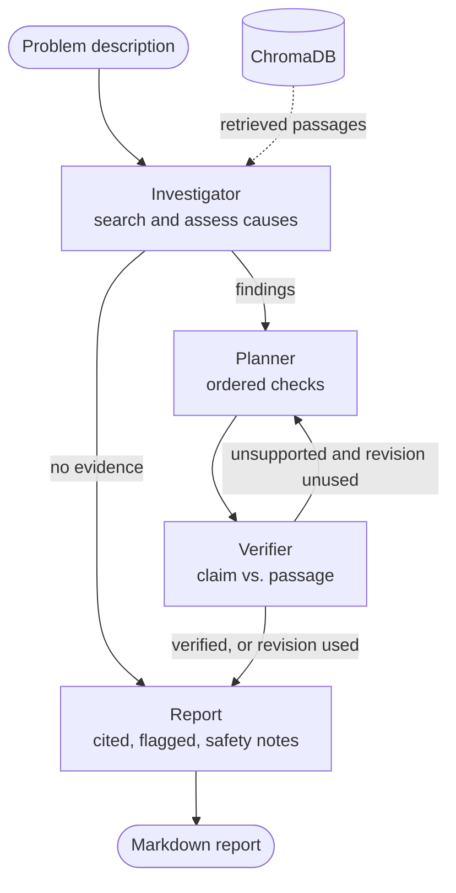

<div align="center">

# ⚙️ Multi-Agent-Engineering-Manuals-Assistant

**A controlled multi-agent assistant that reads equipment manuals, retrieves cited evidence, and produces a verified diagnostic report.**

[](https://www.python.org/)
[](https://langchain-ai.github.io/langgraph/)
[](https://www.langchain.com/)
[](https://groq.com/)
[](https://ai.google.dev/)
[](https://www.trychroma.com/)
[](https://flask.palletsprojects.com/)
[](#-testing)
[](LICENSE)

</div>

<p align="center">
  
</p>

> [!WARNING]
> **EngiGraph is decision support, not an autonomous machine controller.** It never executes equipment commands and never presents unverified procedures as safe instructions. Always confirm values against the original manual and follow your site's safety rules.

---

## ✨ Why EngiGraph?

Equipment manuals are long, and a wrong number or a missed warning is expensive. A plain chatbot will happily invent a bearing-temperature limit. EngiGraph is built around the opposite idea: **every claim must point to a document and page, and anything unsupported is flagged instead of hidden.**

| | |
|---|---|
| 📄 **Cited by default** | Every cause and step carries `[document, page N]`. |
| 🧭 **Controlled workflow** | A LangGraph state machine, not agents chatting freely. Routing is decided by code. |
| 🔍 **Verified, then revised once** | A verifier checks each claim against the retrieved passages; failures trigger exactly one revision. |
| 🚫 **Says "I don't know"** | No evidence in the manuals means an "Insufficient evidence" report, not a guess. |
| 🛡️ **Safety built in** | Safety notes and uncertainty sections appear in every report. |
| 💸 **Runs on free tiers** | Hosted LLM and embeddings, local PDF processing, no Docker, no local models. |

---

## 🏗️ Architecture

### Ingestion (runs on upload)



### Diagnostic workflow (LangGraph)



### The agents

| Role | Responsibility | Uses LLM |
|---|---|:---:|
| **Investigator** | Writes search queries, retrieves passages, lists causes the passages support | ✅ |
| **Planner** | Turns findings into ordered, least-invasive-first diagnostic checks | ✅ |
| **Verifier** | Checks every claim against the cited passages | ✅ + code checks |
| **Report generator** | Formats the cited report, flags uncertainty, appends safety notes | ❌ (pure formatting) |

All agents share **one hosted LLM**; they differ only by prompt and responsibility. Shared state is limited to six keys: `user_query`, `retrieved_chunks`, `findings`, `diagnostic_plan`, `verification_result`, `final_report`.

---

## 🧠 Design decisions

- **Code does not trust the LLM.** After the investigator and planner respond, code drops any citation whose `(document, page)` was not actually retrieved. The verifier also flags missing or invalid citations *without* asking the model.
- **Bounded loops.** `MAX_REVISIONS = 1`, so the planner runs at most twice. Claims still unsupported are marked `⚠️ UNCERTAIN` in the report.
- **Fail early, cheaply.** If retrieval finds no usable evidence, the planner and verifier are skipped entirely.
- **Structured outputs.** Agents return validated Pydantic objects (`with_structured_output`), not free text.
- **Rate-limit aware indexing.** Embedding calls are throttled below the free-tier limit and indexing resumes from where it stopped.
- **Every node is testable alone.** `python main.py node <name> "<problem>"` runs the pipeline up to that node.

---

## 🧰 Tech stack

| Component | Technology |
|---|---|
| Language | Python 3.12 |
| Orchestration | LangGraph |
| LLM integration | LangChain + Groq (`llama-3.3-70b-versatile` by default) |
| Embeddings | Google Gemini embeddings (`gemini-embedding-001`) |
| PDF processing | PyMuPDF |
| Vector database | ChromaDB (persistent, local) |
| Data validation | Pydantic |
| Web UI | Flask + Jinja templates |
| Testing | pytest (fake embeddings and a scripted LLM, no network) |

---

## 🚀 Quickstart

### 1. Clone and install

```bash
git clone https://github.com/<your-username>/engigraph.git
cd engigraph

python -m venv .venv
# Windows:      .venv\Scripts\activate
# macOS/Linux:  source .venv/bin/activate

pip install -r requirements.txt
```

> Need the exact versions this project was tested with? Use `pip install -r requirements.lock.txt`.

### 2. Configure API keys

```bash
cp .env.example .env        # Windows: copy .env.example .env
```

Fill in `.env`:

| Variable | Where to get it |
|---|---|
| `GROQ_API_KEY` | [console.groq.com/keys](https://console.groq.com/keys) |
| `GOOGLE_API_KEY` | [aistudio.google.com/apikey](https://aistudio.google.com/apikey) |

Both have free tiers. **Never commit `.env`.**

### 3. Add documents

PDFs are not redistributed in this repo. Download any text-based equipment manuals into `data/raw_pdfs/`. Good starting points:

- [Baldor/ABB MN409, Large AC Motors Installation & Operating Manual](https://www.baldor.com/mvc/downloadcenter/files/MN409) (troubleshooting tables, limits, safety warnings)
- [NASA NTRS: Damage Propagation Modeling for Aircraft Engine Prognostics](https://ntrs.nasa.gov/api/citations/20090029214/downloads/20090029214.pdf?attachment=true) (a research paper, useful for testing "not in the documents" cases)

Check each document's terms before redistributing it.

### 4. Index and run

```bash
python main.py index          # embeds and stores all PDFs in data/raw_pdfs/
python -m app.flask_app       # then open http://127.0.0.1:5000
```

---

## 🖥️ Web UI

| Library and composer | Cited report |
|:---:|:---:|
|  |  |

- Drag-and-drop PDF upload with background indexing and live status
- Light and dark mode (follows your system)
- Confidence tags, citation chips, flagged uncertainty, safety callouts, and an "Evidence used" panel
- One-click Markdown download of every report
- Clear messages for empty input, missing documents, API limits and bad keys (no stack traces)

---

## ⌨️ Command line

```bash
python main.py llm                                   # test the Groq connection
python main.py pdf data/raw_pdfs/manual.pdf          # test PDF extraction
python main.py index [path] [--force]                # index one PDF or all of them
python main.py search "bearing temperature"          # raw retrieval with distances
python main.py ask "What is the max bearing temperature?"   # baseline cited RAG
python main.py node investigator "motor bearing is overheating"   # test one node
python main.py node planner "motor bearing is overheating"        # up to the planner
python main.py node verifier "motor bearing is overheating"       # up to the verifier
python main.py diagnose "motor bearing is overheating"            # full workflow
```

`diagnose` prints the report and saves it to `reports/last_report.md`.

### Report structure

```markdown
# EngiGraph Diagnostic Report
## Verification
## Findings (possible causes)
- **F1. <cause>** (confidence: high)
  - Evidence: <paraphrase of the passage>
  - Source: [<document>.pdf, page N]
## Suggested diagnostic steps
1. **<check>**
   - Why / Source / ⚠️ Safety
## Uncertainty and limits
## Safety notes
```

---

## 🗂️ Project structure

```
engigraph/
├── app/
│   ├── flask_app.py          # routes, upload, background indexing, error handling
│   └── templates/index.html  # macOS-style UI
├── src/
│   ├── ingestion/
│   │   ├── pdf_loader.py     # PDF text with page numbers
│   │   ├── chunker.py        # page-aware chunking
│   │   └── indexer.py        # embeddings + ChromaDB (throttled, resumable)
│   ├── retrieval/
│   │   └── search.py         # retrieval with source metadata
│   ├── agents/
│   │   ├── investigator.py   # evidence and possible causes
│   │   ├── planner.py        # diagnostic plan
│   │   └── verifier.py       # claim checks and revision decision
│   ├── workflow/
│   │   ├── state.py          # shared state and Pydantic models
│   │   └── graph.py          # LangGraph nodes, edges, routing
│   └── services/
│       ├── llm.py            # model configuration, structured outputs
│       ├── basic_rag.py      # baseline RAG (for the planned comparison)
│       └── report.py         # Markdown report builder
├── tests/                    # offline tests: foundation, retrieval, workflow, app
├── data/
│   ├── raw_pdfs/             # your manuals (not committed)
│   ├── evaluation_questions.json
│   └── chroma_db/            # generated (not committed)
├── docs/                     # project plan and screenshots
├── main.py                   # CLI
├── requirements.txt
└── .env.example
```

---

## 🧪 Testing

```bash
pytest
```

The suite runs **fully offline**: it uses fake embeddings and a scripted LLM, so it needs no API keys, network or money. It covers PDF page numbering, chunk metadata, indexing and resume, retrieval, the happy path, the one-revision loop and its cap, the no-evidence shortcut, invented-citation removal, and the Flask app (validation, uploads, error messages, path-traversal protection).

---

## ⚠️ Free-tier notes

- **Gemini embeddings:** the free tier allows about 100 embedding requests per minute. The indexer throttles to 80/min and retries with a 60-second wait on `429`. If it still fails, rerun `python main.py index`; finished chunks are skipped.
- **Groq:** the free tier has a tokens-per-minute limit. If you see a rate-limit message, wait a minute, or set `GROQ_MODEL=llama-3.1-8b-instant` in `.env` (faster limits, weaker answers).
- **Optional filter:** set `MAX_DISTANCE` in `.env` to drop weakly related passages before the LLM sees them. Tune it from the distances printed by `python main.py search`.

---

## 🗺️ Roadmap

- [x] **Phase 1: Foundation.** Project setup, PDF extraction with page numbers, LLM connection
- [x] **Phase 2: Baseline RAG.** Chunking, embeddings, ChromaDB, cited answers
- [x] **Phase 3: Multi-agent workflow.** LangGraph investigator, planner, verifier, report
- [x] **Phase 4: Application.** Flask UI, upload, error handling, Markdown export
- [ ] **Phase 5: Evaluation.** ~50-question benchmark (answerable, multi-passage, unanswerable); compare baseline RAG with the multi-agent workflow on accuracy, citation support, latency and API cost
- [ ] **Phase 6: Portfolio polish.** Demo recording, measured results, documented limitations

**Deliberately out of scope until the core is proven:** predictive-maintenance ML, real-time sensor feeds, multiple LLMs, a FastAPI service.

---

## 🧱 Known limitations

- Not yet benchmarked: no accuracy or hallucination numbers are claimed until Phase 5 is complete.
- The verifier is itself an LLM and can be wrong; code-level citation checks reduce, but do not remove, that risk.
- Tables that span pages or extract poorly from PDFs can be split across chunks.
- Scanned (image-only) PDFs are not supported; there is no OCR.
- Cited page numbers are **PDF viewer page indexes**, which can differ from the page labels printed in the manual.
- The web app is a single-user development server with no authentication. Run it locally only.
- Designed for English-language documents.

---

## 🔐 Safety

EngiGraph produces *suggested checks for qualified personnel*, grounded in the documents you provide. It does not control equipment, and its output is not a verified procedure. Every report states this, and you should confirm each limit and value on the cited manual page before acting on it.

---

## 🙏 Acknowledgements

Built with [LangGraph](https://langchain-ai.github.io/langgraph/), [LangChain](https://www.langchain.com/), [ChromaDB](https://www.trychroma.com/), [PyMuPDF](https://pymupdf.readthedocs.io/), [Groq](https://groq.com/) and [Google Gemini](https://ai.google.dev/). Sample documents belong to their respective owners (NASA, Baldor/ABB) and are not included in this repository.

## 📄 License

Released under the [MIT License](LICENSE).
